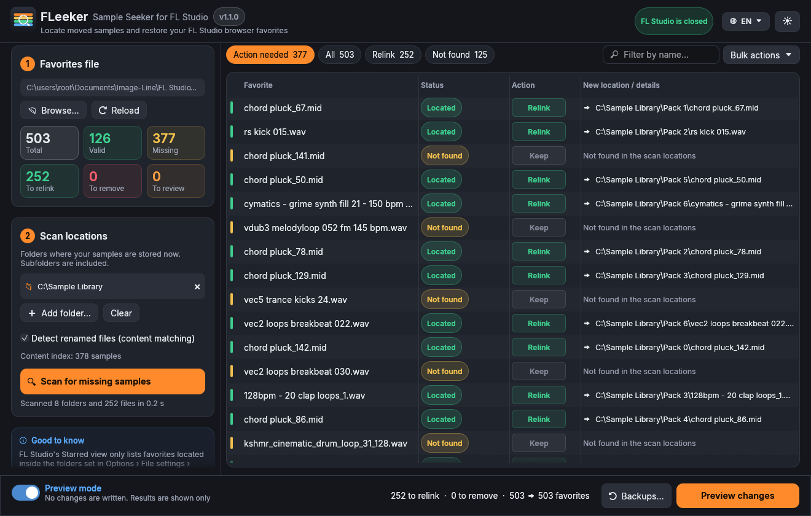

<p align="center">
  
</p>

<h1 align="center">FLeeker</h1>
<p align="center"><b>Sample Seeker for FL Studio</b><br>
Find the samples you moved or renamed and repair your FL Studio browser favorites in one click.</p>

<p align="center">
  <a href="../../releases/latest/download/FLeeker-windows.exe"></a>
  &nbsp;
  <a href="../../releases/latest/download/FLeeker-macos.dmg"></a>
</p>
<p align="center"><sub>Free · Open source · Windows 10/11 and macOS 11+ (Apple Silicon &amp; Intel) · <a href="../../releases">All versions</a></sub></p>

<p align="center">
  
</p>

---

## The problem

You spend months starring your favorite kicks, snares and loops in the FL Studio browser.
Then one day you tidy up your sample folders, move your library to a new drive, or rename a pack…
and your **Starred** list is suddenly full of dead entries. FL Studio doesn't know where the files went,
and fixing hundreds of favorites by hand is not an option.

## The fix

FLeeker reads FL Studio's favorites file, finds every favorite that points to a missing file,
**searches your sample folders for it**, and relinks it to the new location. Done in seconds.

## Features

- **Automatic relinking:** finds moved samples anywhere inside the folders you choose (subfolders included)
- **Finds renamed samples too:** FLeeker remembers the *content* of your valid favorites, so even if you
  later move **and** rename a file, it still recognises it
- **No false matches:** two different samples called `Kick 01.wav` from different packs are told apart
  by their content, so the wrong one is never linked
- **Smart cleanup:** removes duplicate entries and favorites that are already listed under another name
- **Safe by design:**
  - starts in **Preview mode**: nothing is written until you switch to Live mode
  - automatic **backup** before every change, with one-click restore
  - refuses to write while FL Studio is running (FL would overwrite the changes on exit)
  - lines you don't change are kept byte-for-byte identical
- **Fast:** written in Rust, scans thousands of folders in parallel on all CPU cores
- **6 languages:** English, 中文 (Chinese), Deutsch, Español, Français, Italiano (switch from the 🌐 menu)
- **Clean interface:** dark & light themes, filters, search, drag & drop, resizable panels
- **Welcome guide:** a short illustrated tour on first launch (reopen it anytime with the **?** button)
- **Portable:** a single file, no installation, no internet connection, no account

## Download

| System | Download |
|---|---|
| Windows 10 / 11 | **[FLeeker-windows.exe](../../releases/latest/download/FLeeker-windows.exe)** |
| macOS 11+ (Apple Silicon & Intel) | **[FLeeker-macos.dmg](../../releases/latest/download/FLeeker-macos.dmg)** (or **[.zip](../../releases/latest/download/FLeeker-macos.zip)**) |

Older versions and release notes: **[Releases](../../releases)**.

> **Windows:** the first time, SmartScreen may say "Windows protected your PC".
> Click **More info → Run anyway**. The app is not code-signed (signing certificates are expensive),
> but the full source code is right here.
>
> **macOS:** open the `.dmg` and drag **FLeeker** onto the **Applications** folder, then **right-click → Open** it the first time.
> On macOS 15+ you may need **System Settings → Privacy & Security → Open Anyway**.

## How to use it

1. **Close FL Studio.**
2. Open FLeeker. It finds the favorites file (`Tags`) automatically.
3. Add the folders where your samples live **now** (button or drag & drop).
4. Click **Scan for missing samples**.
5. Review the table:

   | Status | Meaning | Default action |
   |---|---|---|
   | 🟢 Located | Found at a new location | Relink |
   | 🔵 Renamed | Found by content under a different name | Relink |
   | 🟠 Needs review | Several different files share this name | Your choice |
   | 🔴 Duplicate entry / Already listed | Redundant favorite | Remove |
   | 🟡 Not found | Not in the scan locations | Keep |

   Click a row for details, click the action to change it.
6. Click **Preview changes**, then switch to **Live mode** and **Apply changes**.
7. Open FL Studio: your favorites are back.

> **Tip:** FL Studio's *Starred* view only lists favorites located inside the folders configured in
> **Options → File settings → Browser extra search folders**. If a relinked favorite doesn't show up,
> add its folder there.

## Where is the favorites file?

FLeeker looks for it automatically. If needed, use **Browse…** and pick the file named `Tags`:

- **Windows:** `Documents\Image-Line\FL Studio\…\Settings\Browser\Tags`
- **macOS:** `~/Documents/Image-Line/FL Studio/…/Settings/Browser/Tags`

## Under the hood

- Rust + [egui](https://github.com/emilk/egui) for a native, GPU-accelerated UI in a single executable
- Parallel directory walking with [rayon](https://github.com/rayon-rs/rayon)
- Content signatures computed with [BLAKE3](https://github.com/BLAKE3-team/BLAKE3), cached by size and
  modification time, so only new or changed files are ever read again
- Atomic writes (temporary file + rename) so the favorites file is never left half-written
- Settings and the content index are stored locally (`%APPDATA%\FLeeker` on Windows,
  `~/Library/Application Support/FLeeker` on macOS). Nothing is ever sent anywhere.

## Build from source

```bash
# Rust 1.85 or newer
cargo build --release
# Windows: target/release/FLeeker.exe  ·  macOS: target/release/FLeeker
cargo test
```

Every push to `main` builds Windows and macOS versions automatically (see the **Actions** tab);
every published release gets the downloads attached.

## Disclaimer

FLeeker is an independent, free and open-source tool. It is **not affiliated with or endorsed by
Image-Line**. FL Studio is a trademark of Image-Line Software. Always keep backups of your work.

## License

[MIT](LICENSE). The bundled Inter and Noto Sans SC fonts are licensed under the SIL Open Font License (see [assets/fonts](assets/fonts/README.md)).
